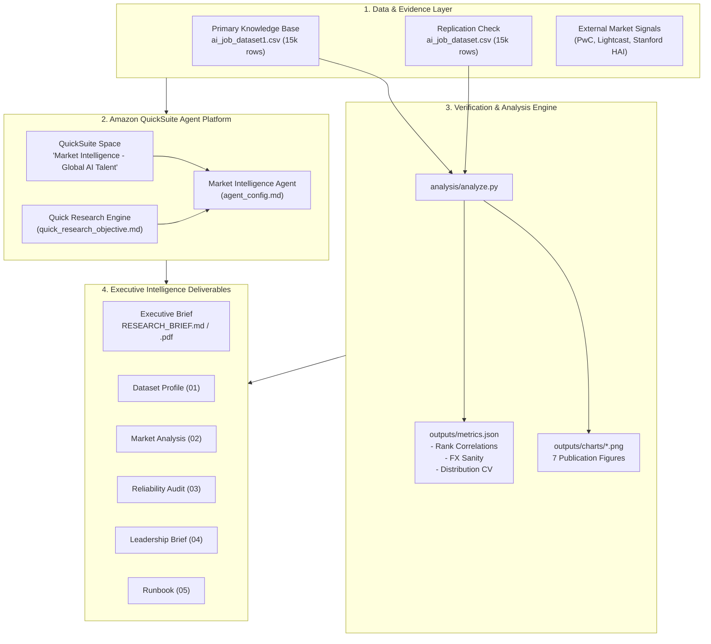

# Market Intelligence Agent — Global AI & Data Talent Market

[](https://www.python.org/)
[](https://aws.amazon.com/)
[](https://www.kaggle.com/)
[](#data-integrity--reliability-framework)
[](LICENSE)

An end-to-end **Market Intelligence Agent** project engineered to analyze global AI and data talent dynamics, compensation structures, and hiring demand for executive decision-making. 

This repository pairs an internal knowledge base (30,000 Kaggle AI job postings across two independent sample files) with verified 2025–2026 external intelligence (PwC, Lightcast, Stanford AI Index) to deliver an audited, leadership-ready strategic research brief, reproducible analytical pipelines, and complete Amazon QuickSuite agent configurations.

---

## 📌 Start Here

* **Executive Deliverable:** [`RESEARCH_BRIEF.pdf`](RESEARCH_BRIEF.pdf) (Markdown source: [`RESEARCH_BRIEF.md`](RESEARCH_BRIEF.md)) — The consolidated, rubric-aligned executive report covering leadership summary, methodology, 6 core insights, chart evidence, audit limitations, and strategic roadmap.
* **QuickSuite Implementation Guide:** [`docs/05_quicksuite_runbook.md`](docs/05_quicksuite_runbook.md) — 8-step deployment runbook for spaces, knowledge bases, agent prompts, and sharing.
* **Agent System Prompts:** [`agent/agent_config.md`](agent/agent_config.md) — Exact instructions, guardrails, and multi-turn prompt templates.

---

## 📊 Executive Summary & Key Findings

| # | Strategic Insight | Evidence Basis | Confidence | Business Implication |
|---|---|---|:---:|---|
| **1** | **Demand Outpaces Market ~8×** | **[EXT]** PwC 2026 reports AI skill jobs up **+69%** vs. **+9%** overall (>1B postings, 27 nations). Lightcast notes US AI share up **+55% YoY** to 2.5%. | **High** *(Direction)* / Med *(Size)* | 2024 hiring models will severely under-budget AI talent acquisition in 2027. |
| **2** | **Seniority is the Primary Pay Lever** | **[DS]** Median rises EN \$66.5k → MI \$91.6k → SE \$128.5k → EX \$197.4k (**2.97× ladder**). Replicates in File A (2.94×); experience-pay correlation $r = 0.74$. | **Medium** | Most budget variance sits in seniority mix, not job title or industry vertical. |
| **3** | **Stable High-Pay Geographic Tier** | **[DS]** Switzerland (\$155k), Norway (\$142k), Denmark (\$138k), and the US (\$124k) lead across both files (+15% to +44% above median). | **Medium** *(Top Tier)* / **Low** *(Rest)* | Build global hiring hubs strategically; 7 of 20 countries (e.g. India, China) show high sample divergence. |
| **4** | **No Reliable Tool-Specific Premium** | **[DS]** Python (30%) and SQL (23%) dominate demand. However, within-level skill premiums are flat (-1.4% to +1.7%; rank correlation $\rho = 0.15$). | **Medium** *(Demand)* / **Low** *(Premium)* | Invest in core algorithmic fundamentals and internal upskilling rather than paying point-tool salary premiums. |
| **5** | **Firm Size Commands +28% Premium** | **[DS]** Large enterprises pay median \$122k vs \$95k for small firms in both files. Remote status (0%, 50%, 100%) shows no salary impact (\$106k–\$109k). | **Low** | Scale-stage organizations must budget higher; do not count on remote hiring discounts. |
| **6** | **Entry-Level Pipeline Compression** | **[EXT]** Stanford HAI 2026: Headcount for software engineers aged 22–25 declined (2021–25). PwC: Junior AI-exposed roles 7× more likely to require senior skills. | **Medium** | "Buy-only" junior talent acquisition will encounter friction; early-career apprenticeships required. |

> **Audit Notice:** Kaggle posting files exhibit synthetic data signatures (constant exchange rates, uniform distributions, generic employers). All dataset-only insights are explicitly capped at **Medium** or **Low** confidence. See [Reliability Evaluation](docs/03_reliability_evaluation.md).

---

## 🏗️ Architecture & Intelligence Workflow



---

## 📈 Visual Evidence Gallery

All visualizations are programmatically generated via [`analysis/analyze.py`](analysis/analyze.py) from the 30,000 raw postings:

| Figure 1: Salary by Seniority Level | Figure 2: Salary by Country (Top Tier) |
|:---:|:---:|
|  |  |
| *Seniority represents a 2.97× ladder from Entry (\$66.5k) to Executive (\$197.4k).* | *Switzerland, Norway, Denmark, and the US form a consistent high-pay cluster.* |

| Figure 3: Sample Replication Audit | Figure 4: Top Skill Frequency |
|:---:|:---:|
|  |  |
| *Replication check: Top tier holds; emerging markets show sample volatility.* | *Python (30%) and SQL (23%) lead aggregate hiring mentions.* |

| Figure 5: Within-Level Skill Premium | Figure 6: Postings Trend Line |
|:---:|:---:|
|  |  |
| *Controlling for level reveals that individual skills yield negligible premiums (<±2%).* | *Postings are uniform across months (~900/mo), proving flat time-series synthetic data.* |

---

## 🔍 Data Integrity & Reliability Framework

This project treats evidence evaluation with scientific rigor:

1. **Independent Replication Protocol:** Both File A and File B share identical `job_id` sequences (AI00001–AI15000) yet have 0% matching salaries. File B was treated as primary; File A as an independent replication benchmark. Rank correlation between files:
   * Company Location: $\rho = 0.80$ (Top tier robust; bottom tier unstable)
   * Job Titles: $\rho = 0.19$ (No stable rank agreement)
   * Industry Sectors: $\rho = -0.14$ (Negative correlation, uncorrelated)
   * Within-Level Skill Premium: $\rho = 0.15$ (No stable rank agreement)
2. **Synthetic Data Detection:**
   * **Constant FX Multipliers:** `salary_local / salary_usd` is completely invariant over 16 months (EUR: 0.850, GBP: 0.750, CHF: 0.900, CAD: 1.250, JPY: 110.000).
   * **Categorical Uniformity:** Coefficients of variation across 20 countries (0.04), 20 titles (0.04), and 15 industries (0.02) indicate synthetic generator balancing rather than organic market postings.
   * **Generic Employer Pool:** Postings are distributed across 16 generic employer placeholder names.
3. **Triangulation with Primary External Research:** Dataset claims are verified against direct publications from **PwC 2026 Global AI Jobs Barometer**, **Lightcast 2026 Report**, and **Stanford HAI 2026 AI Index**.

---

## 📂 Repository Structure

```
market-intelligence-agent/
├── README.md                      # Primary repository documentation & project overview
├── RESEARCH_BRIEF.md              # Consolidated executive brief (rubric-ordered)
├── RESEARCH_BRIEF.pdf              # Publication-grade PDF deliverable
├── requirements.txt               # Python runtime dependencies
├── .gitignore                     # Git tracking exclusions
│
├── agent/                         # QuickSuite Agent configuration & prompts
│   └── agent_config.md            # Name, purpose, instructions, and multi-turn prompts
│
├── analysis/                      # Reproducible analytical pipelines
│   ├── analyze.py                 # Data processing, replication checks, chart generation
│   └── build_brief_pdf.py         # Markdown-to-PDF compilation script
│
├── data/                          # Raw Kaggle posting datasets (unmodified)
│   ├── ai_job_dataset.csv         # File A: 15,000 records, USD salaries (Replication)
│   └── ai_job_dataset1.csv        # File B: 15,000 records, local + USD (Primary KB)
│
├── docs/                          # Detailed milestone documentation & appendix
│   ├── 01_dataset_profile.md      # Schema profiling, column stats, synthetic indicators
│   ├── 02_market_analysis.md      # Detailed competitive, trend, and risk analysis
│   ├── 03_reliability_evaluation.md # Deep-dive confidence matrix and audit cross-checks
│   ├── 04_market_intelligence_brief.md # Standalone leadership brief
│   └── 05_quicksuite_runbook.md   # Step-by-step QuickSuite deployment & submission checklist
│
├── outputs/                       # Analytical artifacts & metrics
│   ├── metrics.json               # Computed metrics, medians, correlations, and CV stats
│   └── charts/                    # 7 high-resolution publication charts (PNG)
│       ├── 01_salary_by_country.png
│       ├── 02_salary_by_title.png
│       ├── 03_top_skills.png
│       ├── 04_skill_premium.png
│       ├── 05_salary_by_level.png
│       ├── 06_postings_trend.png
│       └── 07_replication_country.png
│
└── research/                      # External intelligence & research objectives
    ├── external_signals.md        # Verified external data log (PwC, Lightcast, Stanford)
    └── quick_research_objective.md # Prompts for QuickSuite Quick Research engine
```

---

## 🚀 QuickStart & Reproduction Guide

### Prerequisites
* Python 3.10+
* Git

### 1. Local Environment Setup
```bash
# Clone the repository (or navigate to root)
git clone https://github.com/<your-username>/market-intelligence-agent.git
cd market-intelligence-agent

# Create and activate virtual environment
python -m venv .venv
# Windows (PowerShell):
.venv\Scripts\Activate.ps1
# Linux/macOS:
# source .venv/bin/activate

# Install dependencies
pip install -r requirements.txt
```

### 2. Re-run Analytical Pipeline
```bash
# Process datasets and regenerate metrics.json + all 7 PNG figures
python analysis/analyze.py
```

### 3. Re-generate PDF Deliverable (Optional)
```bash
# Install playwright browser if needed
playwright install chromium
# Rebuild RESEARCH_BRIEF.pdf from RESEARCH_BRIEF.md
python analysis/build_brief_pdf.py
```

---

## 🛠️ Deploying to Amazon QuickSuite

Follow [`docs/05_quicksuite_runbook.md`](docs/05_quicksuite_runbook.md) for full instructions:

1. **Create Space:** Navigate to Amazon QuickSuite → Spaces → `Market Intelligence – Global AI Talent`.
2. **Upload Datasets:** Upload `data/ai_job_dataset.csv` and `data/ai_job_dataset1.csv`.
3. **Instantiate Agent:** Go to Agents → Create Agent. Copy Name, Purpose, and Instructions from [`agent/agent_config.md`](agent/agent_config.md). Attach the Space knowledge base.
4. **Execute Quick Research:** Paste [`research/quick_research_objective.md`](research/quick_research_objective.md) into Quick Research and save findings to the Space.
5. **Run Steps 5–7:** Prompt the agent for Market Analysis, Reliability Table, and Leadership Brief using the prompts in `agent_config.md`.
6. **Share Space:** Set permissions to share the finalized Space and deliverables with reviewers.

---

## 🌐 Linking to GitHub

To push this repository to your own GitHub account:

1. Create an empty repository on GitHub (e.g. named `market-intelligence-agent`). Do **not** initialize it with a README or `.gitignore`.
2. Link your local repository to GitHub:
   ```bash
   git remote add origin https://github.com/<your-username>/market-intelligence-agent.git
   git branch -M main
   git push -u origin main
   ```

---

## 👥 Authors & Acknowledgments

* **Prepared by:** Lisha Bhowmik
* **Framework:** Amazon QuickSuite Market Intelligence Agent
* **External Benchmarks:** PwC 2026 Global AI Jobs Barometer, Stanford HAI 2026 AI Index, Lightcast Research.
